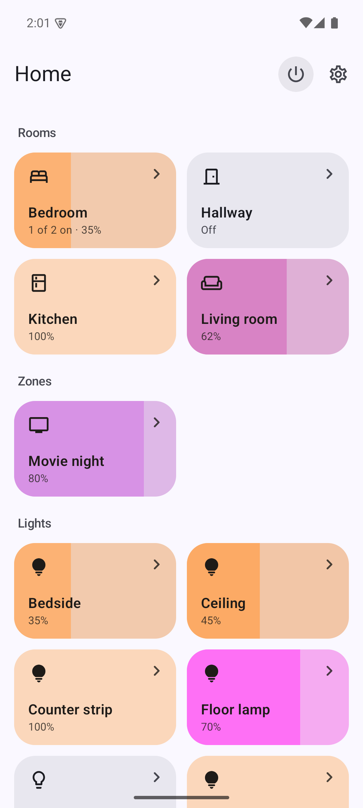
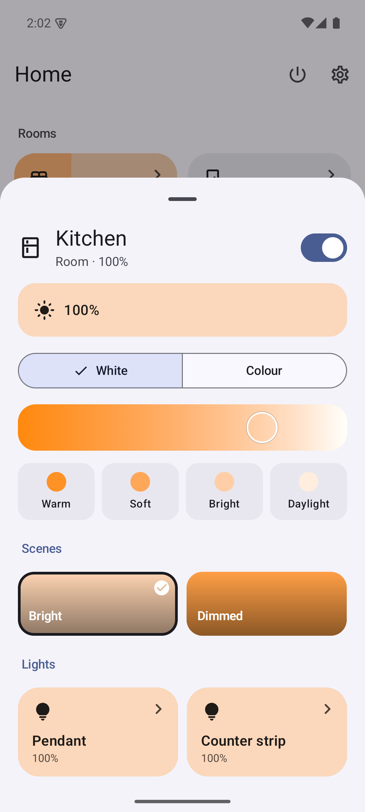

# egHue: Product Spec

**egHue** is a fast, simple Android app for Philips Hue. It doesn't compete on customisation. It
competes on three things:

| Pillar | What it means in practice |
|---|---|
| **Responsiveness** | Every tap updates the screen instantly (optimistic UI) and reaches the bridge over an already-open connection. The app opens on cached state, so there's never a blank screen. |
| **Connectivity** | Finds the bridge by itself, follows it if its IP address changes, routes over Wi-Fi even when mobile data is the default, reconnects when the network changes, and says plainly when it can't reach the bridge. |
| **Control** | Every room, zone and light is one tap away on the home screen. Drag sideways on any tile to dim it. Hue-app scenes, colour and white are one long-press away. |

All screenshots below are from the app running on an Android 15 emulator against a simulated Hue
Bridge (`tools/fake_bridge.py`). Colours follow Material You (wallpaper) on Android 12+, and in-app
light colours match the real lights.

---

## 1. Connecting to the bridge

**Goal: connected in one button press.**

1. **Automatic discovery** runs as soon as the app opens, using three methods at once:
   - mDNS (`_hue._tcp`), which is how the Hue app finds bridges,
   - Philips' discovery service (`discovery.meethue.com`),
   - and, if neither answers within 3 s, a quick scan of the local /24 subnet.

   Every candidate is confirmed by asking it for its bridge ID, so only real Hue bridges appear.
2. **One bridge found** (the usual case): egHue goes straight to *"Press the button on your bridge"*,
   with no extra tap. It polls the bridge every second for 60 s and continues the moment the button is
   pressed.
3. **Several bridges:** pick one from the list.
4. **Fallback:** *Enter IP address instead* (supports `ip:port`).

After pairing, egHue stores the app key and pins the bridge's certificate identity. All traffic is
HTTPS on the local network. No account, no cloud.

 

---

## 2. Home screen

&nbsp;

Everything from the bridge, in three sections: **Rooms**, **Zones** and **Lights**
(alphabetical, carried over exactly from the Hue Bridge).

| Gesture on a tile | Result |
|---|---|
| **Tap** | Toggle on/off (with haptic tick) |
| **Drag left/right** | Dim; the tile fills with the brightness level and the % shows live, with a tick every 10% |
| **Long-press**, or tap **›** | Open full controls |

Each tile shows:
- **Colour:** an *on* tile takes the actual colour of its lights (the average for a room or zone). An *off* tile is neutral.
- **Fill:** the brightness level, as a band from the left.
- **Status:** `65%`, `2 of 3 on · 85%`, `Off`, `Unreachable` or `No lights`.

Top bar: **All off** (turns the whole home off through the bridge's "all lights" group) and
**Settings**. **Pull down** to force a refresh. If the bridge can't be reached, a banner says so
and offers **Retry**, while the last known state stays visible.

---

## 3. Full controls (detail sheet)

&nbsp;

Opens as a bottom sheet over the home screen:

- **Header:** name, status and an on/off switch.
- **Brightness bar:** tap or drag anywhere on it.
- **White | Colour:** shown according to what the lights support.
  - *White:* a warm-to-cool temperature bar plus presets (*Warm*, *Soft*, *Bright*, *Daylight*).
  - *Colour:* a hue/saturation wheel; drag to change colour live.
- **Scenes:** **every scene saved on the bridge, including those created in the Hue app**, shown
  as tiles in the scene's own colours. Tap to activate; the active scene is outlined and ticked.
- **Lights** (rooms and zones): every light in the group, with the same tap, drag and open gestures.
  Opening a light shows its own controls, with a back link to the room.

---

## 4. The widget

&nbsp;

**"Put it on the home screen, tap a room."** That's the whole design.

- **Setup:** when you add the widget, pick which **rooms, zones and/or lights** it shows.
  All rooms are ticked to start with. Long-press the widget › *Reconfigure* to change it later.
- **One tap toggles**, and the tile changes at once. It works even when the app isn't running: the
  widget starts the process, checks the current state if its cache is older than 15 s, then switches.
- **Clear state:** *on* tiles glow in the light's real colour and show the brightness; *off* tiles are
  muted and say `Off`.
- **Responsive layout:** 1 column on narrow widgets, 2 at 4 cells wide, 3 when wider. Tiles grow or
  shrink to fill the height and scroll when there are too many.
- **Stays current:** it refreshes when the app changes something, when another Hue app or switch
  changes something while egHue is open, and every 30 min in the background.
- Follows the system theme (and Material You colours).
- If the bridge can't be reached, a small "Can't reach the bridge" line appears.

---

## 5. Settings

- **Bridge:** name, address and live connection status. **Reconnect** forces a resync and
  re-runs discovery if the IP changed. **Disconnect** forgets the bridge (or **Pair again** if the
  bridge revoked access).
- **Appearance:** Theme **System** (default; follows the device), **Light** or **Dark**.
  **Colours from wallpaper** (Material You, Android 12+); otherwise a warm amber theme.
- **Updates** (see §6): source, the *Automatic updates* switch, the one-time permission to
  install updates, and **Check for updates**.
- **About:** version.

 

---

## 6. Automatic updates

Two builds ("flavors") from one codebase:

| | `github` (now) | `play` (later) |
|---|---|---|
| Delivered by | GitHub Releases of `acc-studio/egHue` | Google Play |
| Checks | On launch (at most every 30 min) and every 6 h in the background | Play's own auto-update, plus an in-app *flexible update* check on launch |
| Install | Downloads in the background. **Silent install on Android 12+** once "Install unknown apps" has been allowed for egHue. On older versions, or before that permission, one tap on the system prompt (or the notification). | Downloads while you use the app |
| First update | The first self-update after installing the APK by hand asks once (*"Do you want to update this app?"*). After that, egHue is the app's installer of record and updates install silently. | n/a |
| Timing | If you're using the app, waits until you leave it, so it never closes under you | Same: completes when you leave the app |
| Safety | Only installs a newer `versionCode` of the same package. Android rejects anything not signed with the same key. | Play-managed |

Verified end to end: an installed 0.1.0 found, downloaded, verified and installed 0.1.1 from this
repo's GitHub Releases, keeping its pairing and settings.

**Shipping an update** is a single command: `git tag v0.2.0 && git push origin v0.2.0`.
GitHub Actions tests, builds and signs both flavors, then publishes the release. Installed apps pick
it up on their own.

---

## 7. How it stays fast and connected (technical)

- **API:** Hue CLIP v2 over HTTPS (`/clip/v2/resource`), plus the bridge's **event stream** (SSE,
  `/eventstream/clip/v2`). Changes from the Hue app, wall switches, automations or other phones show up
  within moments.
- **State model:** a single in-memory copy of the bridge's resources, patched by events. Each command
  adds a short-lived **optimistic overlay**, so the UI updates instantly and a dragging slider isn't
  pulled back by in-flight events. The last state is **cached on disk**, so the app and widget open
  instantly.
- **Command pipeline:** per resource, the first command goes out immediately. Rapid follow-ups (a
  drag) are merged into one request with the latest value, at most every 100 ms per light and
  300 ms per room, following Hue's rate guidance.
- **Connection:** kept-alive HTTPS connections with 3 s connect timeouts. The live connection runs only
  while the app is visible and drops 10 s after you leave (battery). It resyncs on every return.
- **Self-healing:** reconnects with backoff (0.3 s → 8 s). When the network changes it reconnects at
  once. If the bridge doesn't answer, it **rediscovers it by bridge ID** (DHCP moved it) and updates
  the stored address.
- **Network binding:** LAN traffic is pinned to the Wi-Fi network whose subnet contains the bridge.
  This works on Wi-Fi without internet and alongside VPNs.
- **Security:** the bridge certificate must name the paired bridge ID or match the key pinned at
  pairing. Discovery accepts any bridge; after pairing, only yours.
- **Reachability:** lights reported unreachable by the bridge (e.g. switched off at the wall) are
  labelled *Unreachable*.

## 8. Feature parity with the Hue app

| Hue app feature | egHue |
|---|---|
| Rooms and zones from the bridge | ✅ Same rooms, zones and room types (icons) |
| Individual lights | ✅ On the home screen |
| On/off, brightness | ✅ One tap / one drag |
| Colour and white ambience | ✅ Colour wheel, temperature bar, presets |
| Scenes (incl. Hue-app scenes) | ✅ View and activate, with the active scene shown |
| All off | ✅ |
| Live sync with other apps and switches | ✅ Event stream |
| Widget | ✅ Configurable, one-tap |
| Light/dark/system theme | ✅ Plus Material You |
| Creating or editing scenes, rooms, zones | ❌ Out of scope (do it in the Hue app; egHue picks it up live) |
| Automations, routines, Hue Sync, entertainment areas | ❌ Out of scope |
| Control away from home | ❌ Local only for now (needs Hue Remote API credentials; possible later) |
| Adding new lights to the bridge | ❌ Use the Hue app |

## 9. Platform

- Android 8.0+ (minSdk 26), targets Android 15 (API 35). Kotlin, Jetpack Compose, Material 3,
  Jetpack Glance (widget), OkHttp, WorkManager.
- Release APK size: about 2.4 MB.
- Permissions: Internet and network state. The `github` build also requests *Install packages* (self-update) and *Notifications* (update notices).
- Verified by 13 unit tests (state derivation, merging, colour maths, SSE parsing, command
  coalescing, version comparison) and end-to-end on an emulator against `tools/fake_bridge.py`.
